# Потік від сторінки до бази

Навіщо: видно, який API викликає сторінка і яка модель MongoDB стоїть за відповіддю.

Діаграма з’єднує сторінки `app/[lang]/` з маршрутами `app/api/`, сервісами `app/services/` і моделями `app/infrastructure/`. Маршрути, яким потрібен сервіс, беруть його через `app/di/container.ts`. `collaboration/route.ts` лише приймає форму, а `blob-url/route.ts` віддає файл із `public/` і до репозиторію не звертається.

```mermaid
flowchart TD
  artistry["app/[lang]/artistry/page.tsx"]
  research["app/[lang]/research/page.tsx"]
  archive["app/[lang]/archive/page.tsx"]
  contacts["app/[lang]/contacts/page.tsx"]
  cooperation["app/[lang]/cooperation/page.tsx"]
  layout["app/[lang]/layout.tsx"]

  compFilters["app/api/compositions/filters/route.ts"]
  compData["app/api/compositions/data/route.ts"]
  compTitles["app/api/compositions/titles/route.ts"]
  sciFilters["app/api/scientific-works/filters/route.ts"]
  sciData["app/api/scientific-works/data/route.ts"]
  sciTitles["app/api/scientific-works/titles/route.ts"]
  fundsRoute["app/api/funds/route.ts"]
  collabRoute["app/api/collaboration/route.ts"]
  blobRoute["app/api/blob-url/route.ts"]

  artistrySvc["app/services/artistry/artistryService.ts"]
  sciSvc["app/services/scientific-works/scientificWorks.ts"]
  fundsSvc["app/services/funds/fundsService.ts"]

  compRepo["app/infrastructure/repositories/artistry/compositions.repository.ts"]
  sciRepo["app/infrastructure/repositories/scientific-works/scientificWorks.repository.ts"]
  fundsRepo["app/infrastructure/repositories/funds/funds.repository.ts"]

  genre["app/infrastructure/models/artistry/artistryGenreData.ts"]
  category["app/infrastructure/models/artistry/artistryCategoriesData.ts"]
  compositions["app/infrastructure/models/artistry/artistryTableData.ts"]
  opus["app/infrastructure/models/artistry/artistryOpusData.ts"]
  sciWorks["app/infrastructure/models/scientific-works/scientificWorksTableData.ts"]
  sciAuthor["app/infrastructure/models/scientific-works/scientificWorksAuthor.ts"]
  fundModel["app/infrastructure/models/archive/Fund.ts"]
  caseModel["app/infrastructure/models/archive/Case.ts"]
  docModel["app/infrastructure/models/archive/Document.ts"]

  artistry --> compFilters
  artistry --> compData
  artistry --> compTitles
  artistry --> blobRoute
  research --> sciFilters
  research --> sciData
  research --> sciTitles
  archive --> fundsRoute
  contacts --> collabRoute
  cooperation --> collabRoute
  layout --> blobRoute

  compFilters --> artistrySvc
  compData --> artistrySvc
  compTitles --> artistrySvc
  sciFilters --> sciSvc
  sciData --> sciSvc
  sciTitles --> sciSvc
  fundsRoute --> fundsSvc

  artistrySvc --> compRepo
  sciSvc --> sciRepo
  fundsSvc --> fundsRepo

  compRepo --> genre
  compRepo --> category
  compRepo --> compositions
  compRepo --> opus
  sciRepo --> sciWorks
  sciRepo --> sciAuthor
  fundsRepo --> fundModel
  fundsRepo --> caseModel
  fundsRepo --> docModel
```

